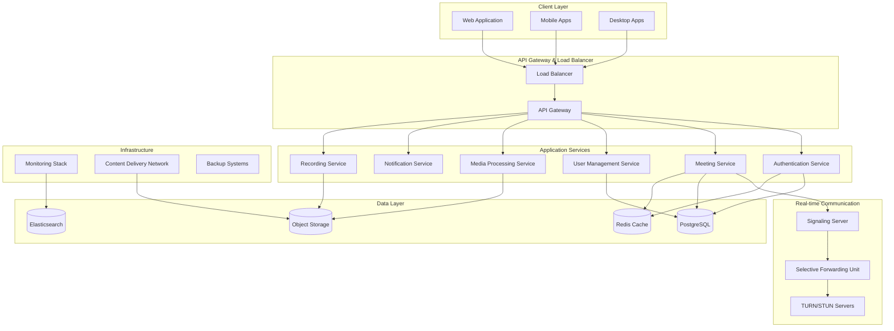
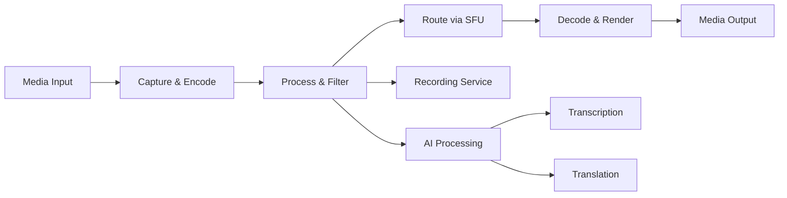

# Production-Ready Video Conferencing Design Document

## Overview

This design document outlines the architecture and implementation strategy for transforming the current Google Meet clone into a production-ready, enterprise-grade video conferencing platform. The design addresses scalability, security, reliability, and maintainability while building upon the existing React/Node.js foundation.

## Architecture

### High-Level Architecture



### Microservices Architecture

The application will be restructured into microservices for better scalability and maintainability:

1. **Authentication Service** - User authentication, authorization, SSO integration
2. **Meeting Service** - Meeting lifecycle management, room operations
3. **User Management Service** - User profiles, preferences, organization management
4. **Media Processing Service** - Video/audio processing, recording, transcription
5. **Notification Service** - Email, SMS, push notifications, calendar integration
6. **Recording Service** - Meeting recording, storage, playback
7. **Analytics Service** - Usage analytics, reporting, monitoring

## Components and Interfaces

### Frontend Architecture

#### Component Structure
```
src/
├── components/
│   ├── common/           # Reusable UI components
│   ├── auth/            # Authentication components
│   ├── meeting/         # Meeting-related components
│   ├── admin/           # Admin dashboard components
│   └── mobile/          # Mobile-specific components
├── services/            # API service layers
├── hooks/               # Custom React hooks
├── context/             # React context providers
├── utils/               # Utility functions
├── types/               # TypeScript type definitions
└── tests/               # Test files
```

#### Key Frontend Components

**Authentication Components:**
- `LoginForm` - Multi-factor authentication support
- `SSOProvider` - Single sign-on integration
- `UserProfile` - User settings and preferences

**Meeting Components:**
- `MeetingLobby` - Pre-meeting setup and waiting room
- `VideoConference` - Main meeting interface
- `ScreenShare` - Screen sharing functionality
- `Whiteboard` - Collaborative whiteboard
- `BreakoutRooms` - Breakout room management

**Admin Components:**
- `AdminDashboard` - System administration
- `UserManagement` - User and organization management
- `Analytics` - Usage analytics and reporting

#### State Management
- **Redux Toolkit** for global state management
- **React Query** for server state and caching
- **Zustand** for lightweight local state

### Backend Architecture

#### Service Layer Structure
```
services/
├── auth-service/
│   ├── controllers/
│   ├── middleware/
│   ├── models/
│   └── routes/
├── meeting-service/
├── user-service/
├── media-service/
├── notification-service/
└── shared/
    ├── database/
    ├── middleware/
    ├── utils/
    └── types/
```

#### API Design

**RESTful APIs:**
- Authentication: `/api/v1/auth/*`
- Users: `/api/v1/users/*`
- Meetings: `/api/v1/meetings/*`
- Organizations: `/api/v1/organizations/*`
- Analytics: `/api/v1/analytics/*`

**WebSocket Events:**
- Meeting signaling: `meeting:*`
- Chat messages: `chat:*`
- Participant updates: `participant:*`
- System notifications: `system:*`

**GraphQL API:**
- Unified data fetching for complex queries
- Real-time subscriptions for live updates
- Type-safe schema with automatic documentation

### Real-time Communication

#### WebRTC Architecture
- **Selective Forwarding Unit (SFU)** for efficient media routing
- **TURN/STUN servers** for NAT traversal
- **Adaptive bitrate streaming** for varying network conditions
- **End-to-end encryption** for secure communication

#### Media Processing Pipeline


## Data Models

### Core Entities

#### User Model
```typescript
interface User {
  id: string;
  email: string;
  name: string;
  avatar?: string;
  organizationId?: string;
  role: UserRole;
  preferences: UserPreferences;
  createdAt: Date;
  updatedAt: Date;
  lastLoginAt?: Date;
  isActive: boolean;
}

interface UserPreferences {
  defaultAudioMuted: boolean;
  defaultVideoMuted: boolean;
  virtualBackground?: string;
  language: string;
  timezone: string;
  notifications: NotificationSettings;
}
```

#### Meeting Model
```typescript
interface Meeting {
  id: string;
  title: string;
  description?: string;
  hostId: string;
  organizationId?: string;
  scheduledAt?: Date;
  startedAt?: Date;
  endedAt?: Date;
  duration?: number;
  status: MeetingStatus;
  settings: MeetingSettings;
  participants: Participant[];
  recordings: Recording[];
  createdAt: Date;
  updatedAt: Date;
}

interface MeetingSettings {
  isPublic: boolean;
  requirePassword: boolean;
  password?: string;
  waitingRoomEnabled: boolean;
  recordingEnabled: boolean;
  maxParticipants: number;
  allowScreenShare: boolean;
  allowChat: boolean;
  muteParticipantsOnJoin: boolean;
}
```

#### Organization Model
```typescript
interface Organization {
  id: string;
  name: string;
  domain: string;
  settings: OrganizationSettings;
  subscription: Subscription;
  createdAt: Date;
  updatedAt: Date;
}

interface OrganizationSettings {
  ssoEnabled: boolean;
  ssoProvider?: string;
  maxMeetingDuration: number;
  recordingRetentionDays: number;
  allowExternalParticipants: boolean;
  requireMeetingPasswords: boolean;
  enableWaitingRoom: boolean;
}
```

### Database Schema

#### PostgreSQL Tables
- `users` - User accounts and profiles
- `organizations` - Organization/tenant data
- `meetings` - Meeting metadata and settings
- `participants` - Meeting participation records
- `recordings` - Recording metadata and locations
- `chat_messages` - Chat message history
- `audit_logs` - System audit trail
- `user_sessions` - Active user sessions

#### Redis Cache Structure
- `session:{sessionId}` - User session data
- `meeting:{meetingId}` - Active meeting state
- `user:{userId}:presence` - User presence information
- `rate_limit:{userId}` - Rate limiting counters

## Error Handling

### Error Classification
1. **Client Errors (4xx)** - Invalid requests, authentication failures
2. **Server Errors (5xx)** - System failures, service unavailable
3. **WebRTC Errors** - Connection failures, media access issues
4. **Network Errors** - Connectivity issues, timeouts

### Error Response Format
```typescript
interface ErrorResponse {
  error: {
    code: string;
    message: string;
    details?: any;
    timestamp: string;
    requestId: string;
  };
}
```

### Retry and Fallback Strategies
- **Exponential backoff** for transient failures
- **Circuit breaker pattern** for service failures
- **Graceful degradation** for non-critical features
- **Automatic reconnection** for WebSocket connections

## Testing Strategy

### Testing Pyramid

#### Unit Tests (70%)
- Component testing with React Testing Library
- Service layer testing with Jest
- Utility function testing
- Database model testing

#### Integration Tests (20%)
- API endpoint testing
- Database integration testing
- WebSocket event testing
- Third-party service integration testing

#### End-to-End Tests (10%)
- User journey testing with Playwright
- Cross-browser compatibility testing
- Mobile app testing with Appium
- Performance testing with k6

### Test Automation
- **Continuous Integration** with GitHub Actions
- **Automated testing** on pull requests
- **Performance regression testing**
- **Security vulnerability scanning**

### Quality Gates
- Minimum 80% code coverage
- All tests must pass
- Security scan must pass
- Performance benchmarks must be met

## Security Implementation

### Authentication & Authorization
- **JWT tokens** with refresh token rotation
- **Multi-factor authentication** (TOTP, SMS, email)
- **Single Sign-On** (SAML 2.0, OAuth 2.0, OpenID Connect)
- **Role-based access control** (RBAC)

### Data Protection
- **End-to-end encryption** for media streams
- **AES-256 encryption** for data at rest
- **TLS 1.3** for data in transit
- **Key rotation** and management

### Security Headers
```typescript
const securityHeaders = {
  'Strict-Transport-Security': 'max-age=31536000; includeSubDomains',
  'Content-Security-Policy': "default-src 'self'; script-src 'self' 'unsafe-inline'",
  'X-Frame-Options': 'DENY',
  'X-Content-Type-Options': 'nosniff',
  'Referrer-Policy': 'strict-origin-when-cross-origin'
};
```

### Compliance Features
- **GDPR compliance** - Data portability, right to deletion
- **HIPAA compliance** - Audit logs, access controls
- **SOC 2 compliance** - Security monitoring, incident response

## Performance Optimization

### Frontend Optimization
- **Code splitting** and lazy loading
- **Image optimization** and WebP support
- **Service worker** for offline functionality
- **Bundle size optimization** with tree shaking

### Backend Optimization
- **Database indexing** and query optimization
- **Connection pooling** for database connections
- **Caching strategies** with Redis
- **CDN integration** for static assets

### Media Optimization
- **Adaptive bitrate streaming**
- **Video codec optimization** (VP9, H.264, AV1)
- **Audio processing** with noise cancellation
- **Bandwidth management** and quality adaptation

## Deployment and Infrastructure

### Container Architecture
```dockerfile
# Multi-stage build for production optimization
FROM node:18-alpine AS builder
WORKDIR /app
COPY package*.json ./
RUN npm ci --only=production

FROM node:18-alpine AS runtime
WORKDIR /app
COPY --from=builder /app/node_modules ./node_modules
COPY . .
EXPOSE 3000
CMD ["npm", "start"]
```

### Kubernetes Deployment
- **Horizontal Pod Autoscaling** based on CPU/memory usage
- **Service mesh** with Istio for traffic management
- **ConfigMaps and Secrets** for configuration management
- **Persistent volumes** for data storage

### CI/CD Pipeline
```yaml
stages:
  - test
  - security-scan
  - build
  - deploy-staging
  - integration-tests
  - deploy-production
```

### Monitoring and Observability
- **Application metrics** with Prometheus
- **Distributed tracing** with Jaeger
- **Log aggregation** with ELK stack
- **Real-time alerting** with PagerDuty integration

This comprehensive design provides a roadmap for transforming the current prototype into a production-ready, enterprise-grade video conferencing platform that meets all the specified requirements while maintaining scalability, security, and reliability.